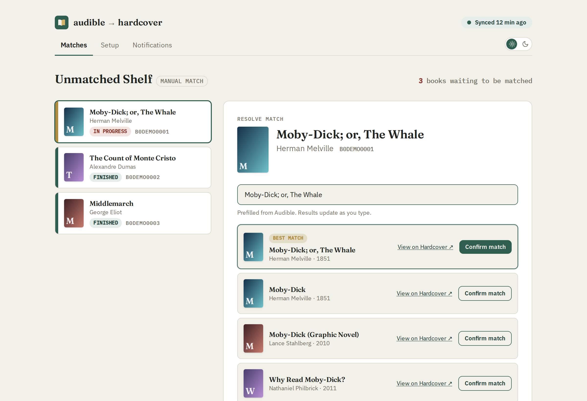
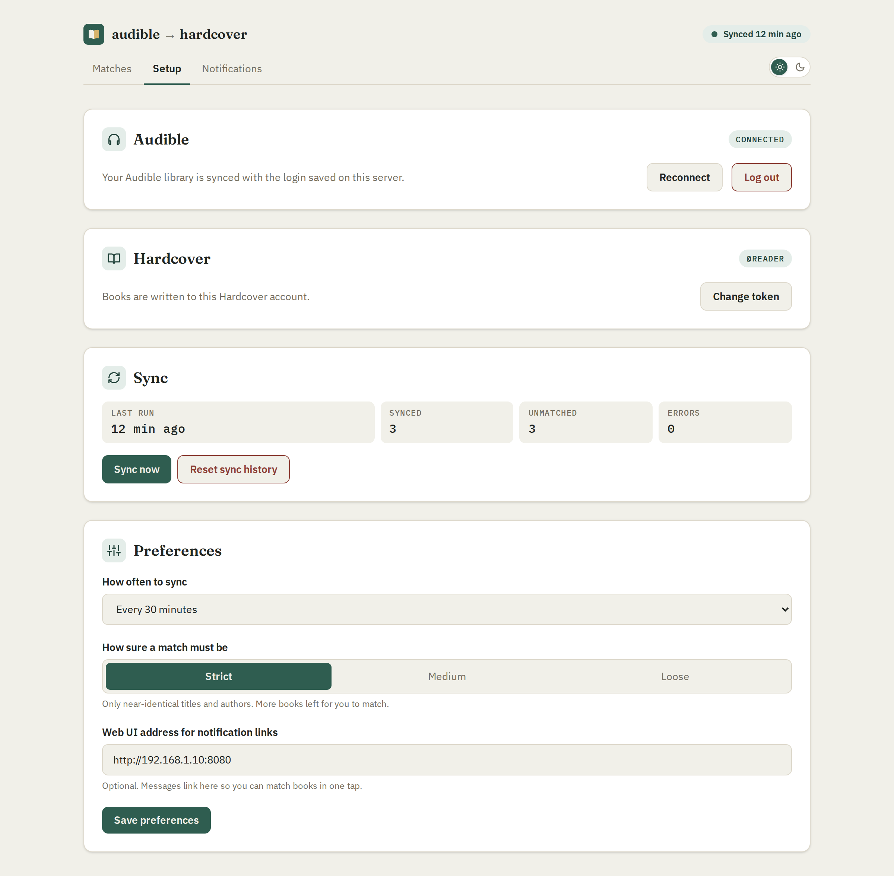
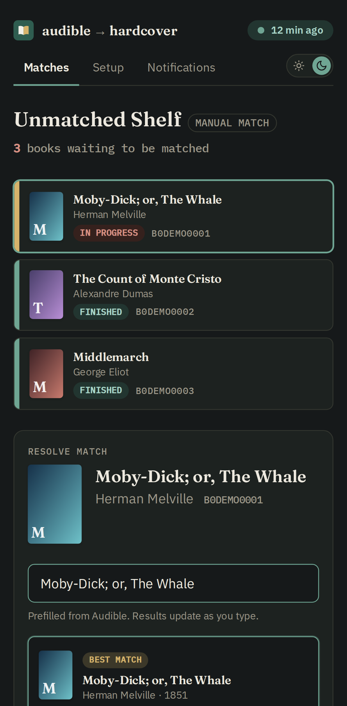
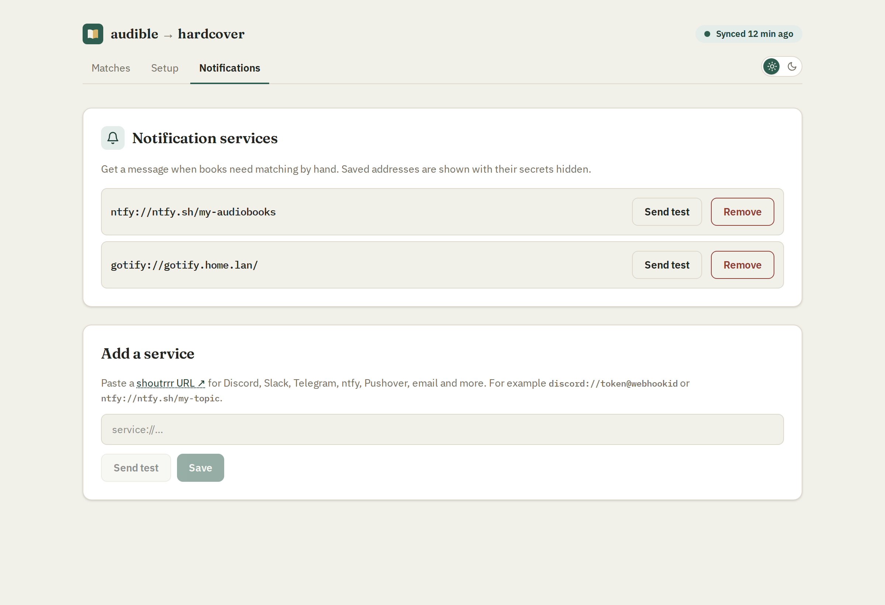
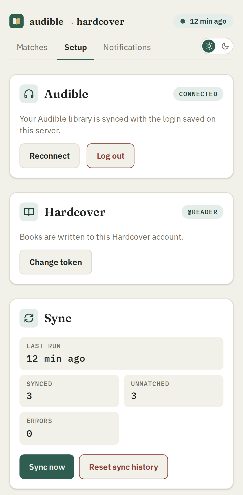

<h1 align="center">
  <br>
  audible-hardcover-sync
</h1>

<p align="center">
  Keep your <a href="https://hardcover.app">Hardcover</a> shelves in step with what you listen to on Audible.
</p>

<p align="center">
  <a href="https://github.com/kbuechl/audible-hardcover-sync/actions/workflows/docker.yml"></a>
  <a href="https://github.com/kbuechl/audible-hardcover-sync/pkgs/container/audible-hardcover-sync"></a>
  
  <a href="LICENSE"></a>
</p>

<p align="center">
  
</p>

## Features

- **Finished books become Read, in-progress books Currently Reading**, with
  the audiobook edition, finish date, your Audible star rating and
  listening progress.
- **Re-listens count.** Starting a Read book again on Audible adds a new
  read on Hardcover instead of overwriting the old one.
- **Never undoes your edits.** Books already on your Hardcover shelves keep
  their status, rating and dates; only listening progress moves forward.
- **Matches it can't make alone wait for you.** The web UI suggests the
  likeliest Hardcover book; confirm it in one tap, on desktop or phone.
- **Notifications** to Discord, Slack, ntfy, Telegram, email and
  [more](https://containrrr.dev/shoutrrr/) when books need you.
- **Set up entirely in the browser.** Connect Audible and Hardcover,
  pick a schedule and add notifications without touching a config file.

## How it works

<picture>
  <source media="(prefers-color-scheme: dark)" srcset="assets/how-it-works-dark.svg">
  
</picture>

Audible has no public API, so this uses a vendored, extended fork of the
reverse-engineered [`go-audible`](https://github.com/mstrhakr/go-audible)
client. Each sync reads your library and listening progress, matches
every book to Hardcover by ISBN or ASIN first and then by a scored
title-and-author search, and writes the result. See
[Sync behavior](#sync-behavior) for the details.

> [!WARNING]
> **The web UI has no login.** Anyone who can reach it can see your
> library and change matches that are written to your Hardcover account.
> Run it on your home network or behind a VPN only. Don't port-forward it,
> and don't put it behind a public reverse proxy without adding
> authentication in front of it.

## Requirements

- Docker with the Compose plugin (amd64 or arm64).
- An Audible account on the **US** marketplace (audible.com). Other
  marketplaces aren't supported yet.
- A Hardcover account and API token: hardcover.app → Settings → API.
  Pick the **E-reader / sync client** preset when creating the token. It
  covers everything the app needs; avoid `all`. If you'd rather choose
  scopes yourself, these are the minimum:

  | Scope | Used for |
  |---|---|
  | `read:catalog` | Finding your Audible books on Hardcover |
  | `read:library` | Checking what's already on your shelf, including private entries |
  | `read:me:content` | Showing your username on the Setup page |
  | `write:library` | Adding books and updating status and reading progress |

## Quick start

1. Get the compose file and start it:
   ```bash
   mkdir audible-hardcover-sync && cd audible-hardcover-sync
   curl -fsSLO https://raw.githubusercontent.com/kbuechl/audible-hardcover-sync/main/docker-compose.yml
   docker compose up -d
   ```
2. Open `http://localhost:8080` and finish the first-time setup below.

The compose file only listens on the machine itself. To open the UI from
another device on your network, change `127.0.0.1:8080:8080` in
`docker-compose.yml` to `<your LAN IP>:8080:8080`.

> [!IMPORTANT]
> ### First-time setup
>
> The UI opens on **Setup** until both accounts are connected.
>
> 1. **Connect Audible.** Sign in on the Amazon page that opens. You'll
>    land on a page that may look like an error: copy its full address
>    and paste it back into the UI.
> 2. **Add your Hardcover token** from hardcover.app → Settings → API. It's
>    checked, saved on the server and never shown again.
> 3. **Pick a schedule** under Preferences (default every 6 hours) and
>    press **Sync now**.
>
> The first sync of a large library takes a while: Hardcover's free API
> allows about 60 requests a minute, and the tool paces itself to that.
> Afterwards, check **Matches** for books it couldn't place, and add a
> **Notifications** service to hear about new ones.

<table>
  <tr>
    <td width="62%"></td>
    <td width="38%"></td>
  </tr>
  <tr>
    <td></td>
    <td></td>
  </tr>
</table>

Prefer the terminal? `docker compose run --rm sync-tool auth` connects
Audible from there instead, and `HARDCOVER_API_TOKEN` can supply the
token (see [Configuration](#configuration)).

### Already running Compose stacks?

Add the service to an existing compose file instead:

```yaml
  audible-hardcover-sync:
    image: ghcr.io/kbuechl/audible-hardcover-sync:latest
    restart: unless-stopped
    volumes:
      - ./audible-hardcover-sync:/data
    ports:
      # No login on the web UI: LAN only, never exposed to the internet.
      - 8080:8080
```

Then `docker compose up -d audible-hardcover-sync` and finish setup in
the web UI.

## Configuration

Sync schedule, match strictness and the address used in notification
links are set in the web UI under **Setup → Preferences**. The rest is
optional environment variables, set in `.env` or the service's
`environment`.

| Variable | Default | What it does |
|---|---|---|
| `HARDCOVER_API_TOKEN` | | Your Hardcover API token, instead of setting it in the UI. When set, the UI can't change it. |
| `CREDENTIALS_KEY` | | Opt-in: a passphrase that encrypts the saved Audible login and Hardcover token (AES-256-GCM). See [Credentials](#credentials). |

Everything the tool saves (`state.db`, `credentials.json` and
`hardcover-token`) goes in the `/data` volume. To change the web UI's port, change the host side of the
port mapping (e.g. `9000:8080`).

Running the binary outside Docker? `DATA_DIR` (default `/data`) and
`WEB_UI_PORT` (default `8080`) set the data folder and listen port.

## Credentials

Connecting Audible registers this tool as an Audible device and saves
that device's tokens to `/data/credentials.json`. A Hardcover token
entered in the UI is saved to `/data/hardcover-token`. Both files have
owner-only permissions. Your Amazon password is never stored.

The web UI never shows either one again: it only shows whether each is
connected and your Hardcover username. Anyone with the files themselves
can use your accounts, though.

- **Plain by default.** Without `CREDENTIALS_KEY` the files are stored
  as-is.
- **Opt-in encryption.** Set `CREDENTIALS_KEY` to any long passphrase
  (e.g. `openssl rand -base64 32`). Existing files are encrypted on the
  next start or sync, with no new login needed. This mostly protects
  copies of the data folder, like backups, so keep the key somewhere
  other than that folder.
- **Lost the key?** Delete both files and connect again in the UI.
- **Log out.** Setup → Audible → **Log out** removes the device from your
  Amazon account and deletes the saved login. If the file ever leaks,
  you can also remove the device on Amazon (Manage Your Content and
  Devices → Devices).

## Commands

The image's entrypoint is `sync-tool`; the default command is `serve`.

| Command | What it does |
|---|---|
| `docker compose run --rm sync-tool auth` | Log in to Audible from the terminal instead of the UI. |
| `docker compose run --rm sync-tool sync` | Run one sync now and exit. |
| `docker compose up -d` | Run the web UI, sync at start and then on the schedule set in the UI. |

## Updating

```bash
docker compose pull && docker compose up -d
```

Images are tagged `latest` (the `main` branch), `sha-<commit>`, and a
version (`1.2.3`, `1.2`) for each release. Pin a version tag for
predictable updates.

Not using Docker? Each [release](https://github.com/kbuechl/audible-hardcover-sync/releases)
also has `sync-tool` binaries for Linux, macOS and Windows (amd64 and
arm64). Run `sync-tool serve`, with `DATA_DIR` pointing at a writable
folder.

## Troubleshooting

- **`skipping sync until setup is finished`** in the logs: Audible or
  Hardcover isn't connected yet. Open the web UI's Setup page.
- **Audible errors after it worked before**: the saved login expired.
  Setup → Audible → **Reconnect**.
- **`file is encrypted; set CREDENTIALS_KEY`**: the key was removed or
  changed. Put it back, or delete the saved files and connect again.
- **Lots of `unmatched`**: Hardcover search was down or the books aren't in
  its catalog. Unmatched books are retried every sync; match the rest by
  hand in the web UI.
- **`status 429` / `408` in the logs**: Hardcover rate limits or timeouts.
  Lookups are retried; failed writes are picked up on the next sync.
- **Start over**: Setup → Sync → **Reset sync history**. Your Hardcover
  library, logins and notification settings are kept; the next sync
  re-checks every book.

## Sync behavior

- **Matching priority.** The sync matches on ISBN/ASIN exactly first, then
  falls back to a confidence-scored fuzzy title/author match. The fuzzy
  threshold is set under **Setup → Preferences**: Strict (0.95, default),
  Medium (0.75) or Loose (0.55).
- **Existing entries are skipped.** If a book is already in your Hardcover
  library (any status — Read, Currently Reading, Want to Read), the sync
  will NOT modify it:
  - A book you read in print and marked Read will NOT be downgraded to
    Currently Reading when you start the audiobook on Audible.
  - A rating you set on Hardcover will NOT be overwritten by your Audible
    rating.
  - A finish date you set manually on Hardcover will NOT be overwritten.
  - The one exception is listening progress: for a book that is Currently
    Reading on Hardcover, progress is moved forward to match Audible on each
    sync. It is never lowered, and nothing else about the entry changes.
  - Re-listens add a new read. When a book is Read on Hardcover and you
    start it again on Audible (back at 10% or less), or start the audiobook
    of a book you read elsewhere, the sync adds a new read to the entry,
    keeps its progress moving forward, and finishes it when Audible does.
    The entry stays Read. Progress synced to Hardcover from other apps
    (Kobo, CWA) never starts a re-listen.
- **New entries get.** When a book is not already on Hardcover, the sync
  inserts it with:
  - Status (Read for finished, Currently Reading for in-progress).
  - The audiobook edition (matched by Audible ASIN, falling back to any
    edition with audio duration).
  - The finish date from Audible's listening history (finished books only).
  - Your Audible star rating (if you've rated the book on Audible).
  - Listening progress (in-progress books), from Audible's percent complete
    and the audiobook's runtime.
- **Rate limiting.** Throttled requests (HTTP 429) are retried with
  exponential backoff for read operations (searches, lookups), but
  mutations (inserts/updates) are NOT retried to prevent duplicate
  entries.

## Development

```bash
go test ./...                                  # backend
cd internal/webui/frontend && npm ci && npm test   # web UI
npm run build                                  # rebuild the embedded UI (commit dist/)
npm run screenshots                            # regenerate the README screenshots
npm run diagram                                # redraw assets/how-it-works.mmd as SVG
```

Releases: push a `v1.2.3` tag. GoReleaser publishes the binaries and
changelog, and the image workflow pushes the matching version tags.

The screenshots use made-up data (public-domain books, placeholder
accounts) served by a mocked API, so no real library ever ends up in the
repo.

## License

MIT — see [LICENSE](LICENSE).

## Third-party licenses

See [THIRD_PARTY_LICENSES.md](THIRD_PARTY_LICENSES.md) for a full list of
vendored source and dependencies with their licenses.

